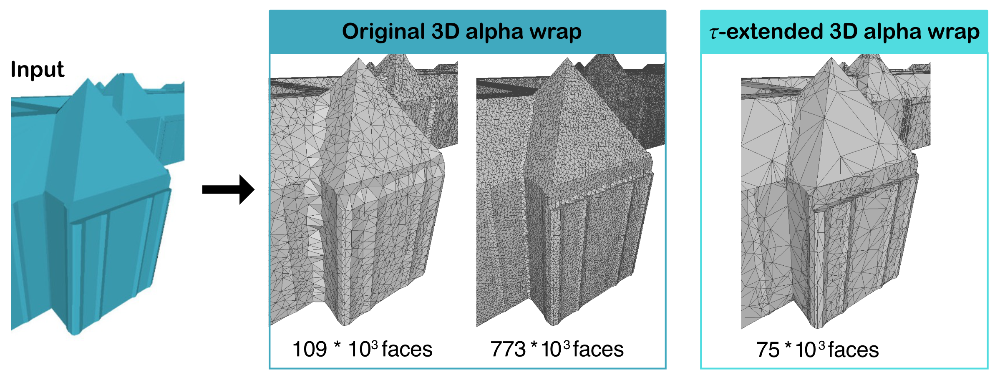
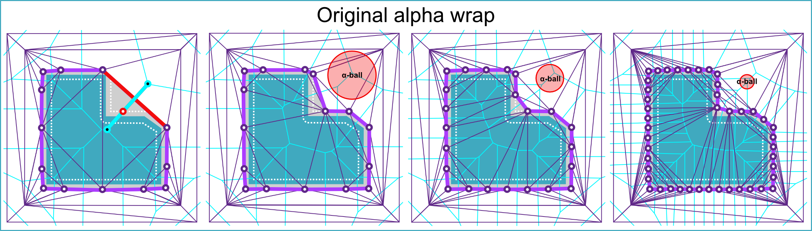
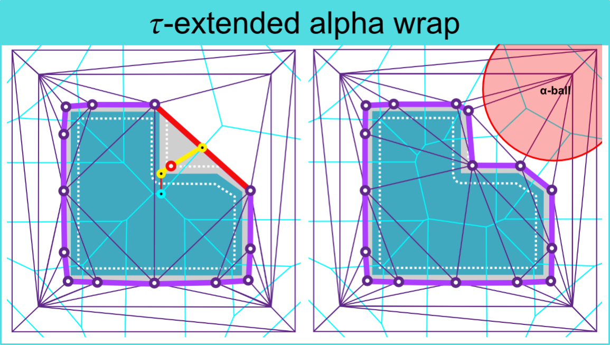
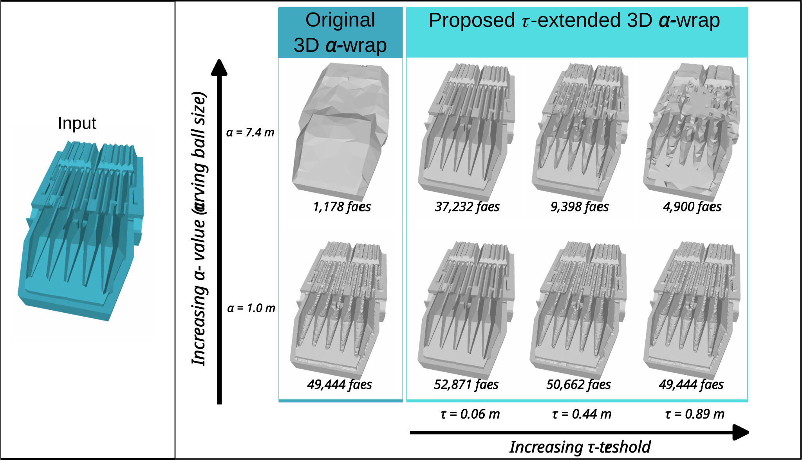

# Extended 3D Alpha Wrap

This repository contains an extension of CGAL’s 3D Alpha Wrap algorithm. The extension can be used in two ways: through the command-line interface (`alpha_wrap_cli`), or directly in C++ in the same way as the original 3D Alpha Wrap.

The extension adds an extra parameter, `tau`, through `max_distance_to_input(tau)`. It triggers additional refinement only where the current wrap remains locally too far from the input. During wrapping, triangle facet midpoints are checked against this distance threshold, allowing refinement to continue even where the original `alpha` criterion would stop. This refinement is complemented by an additional vertex insertion strategy that places points more directly in concave corners, reducing the number of vertices needed in the final mesh. Together, these additions help preserve small concave details without requiring a globally smaller `alpha`.

The extension retains the guarantees of the original algorithm: termination, strict enclosure of the input, watertightness, orientability, and manifoldness.



The following 2D schematics illustrate the difference between the two algorithms. For a detailed explanation of how the extension works, see the [paper](Paper_alpha_wrap.pdf).

<table width="100%">
  <tr>
    <td width="66.47%"></td>
    <td width="33.53%"></td>
  </tr>
</table>

## Data formats

Like the original CGAL 3D Alpha Wrap, the extended algorithm accepts **triangle meshes, triangle soups, and point sets**. These are geometry types passed to the C++ interface; the file format depends on how the data is loaded.

The CLI additionally accepts **meshes with non-triangular faces** and automatically triangulates them before calling the algorithm.

### CLI file formats

The CLI uses CGAL’s readers and writers to load and save files:

**Input formats**

| Geometry | Supported file formats |
| --- | --- |
| Polygon mesh | OFF, OBJ, STL, PLY |
| Point cloud | XYZ, PWN, OFF, PLY |

**Output formats**

The CLI writes a triangle mesh as OFF, OBJ, STL, or PLY. The extension of the output filename selects the format; for example, `output.stl` produces an STL file.

LAS point-cloud input and VTP mesh input/output are available when the corresponding optional CGAL dependencies are enabled. The CLI detects whether the input is a mesh or a point cloud automatically.

## Installation

### Clone

```bash
git clone <repo-url>
cd <repo-directory>
```

### Prerequisites

- CMake 3.16 or newer
- A C++20 compiler
- CGAL and its dependencies
- Optional: [val3dity](https://github.com/tudelft3d/val3dity), required at runtime for the CLI options `--validate` and `--wrap_invalid_only`

Install the build prerequisites with one command:

**Linux (Ubuntu/Debian)**

```bash
sudo apt-get update && sudo apt-get install -y build-essential cmake git libcgal-dev
```

**macOS (with [Homebrew](https://brew.sh/) installed)**

```bash
brew install cmake git cgal
```

On macOS, the compiler is provided by Xcode Command Line Tools, which Homebrew requires. If needed, install them first with `xcode-select --install`.

These commands install CGAL and its package dependencies (see the [CGAL Linux instructions](https://www.cgal.org/download/linux.html) and [Homebrew CGAL package](https://formulae.brew.sh/formula/cgal)). The optional [val3dity](https://github.com/tudelft3d/val3dity) executable must be installed separately.

### Build

From the repository root:

```bash
cmake -S . -B build -DCMAKE_BUILD_TYPE=Release
cmake --build build --target alpha_wrap_cli example_usage
```

If `val3dity` is not on your `PATH`, specify its location when configuring:

```bash
cmake -S . -B build -DCMAKE_BUILD_TYPE=Release -DVAL3DITY_EXECUTABLE=/path/to/val3dity
```

## Command-line interface

Run the CLI from the repository root:

```bash
./build/alpha_wrap_cli <input_path> <output_path> <alpha> <offset> <tau> [--validate] [--wrap_invalid_only] [--use_normal_alpha_wrap]
```

| Argument | Meaning |
| --- | --- |
| `input_path` | Input mesh or point-cloud file. |
| `output_path` | Output mesh file; its extension selects the format. |
| `alpha` | Carving-ball size; must be finite and positive. |
| `offset` | Distance of inserted vertices from the input; must be finite and positive. |
| `tau` | Distance threshold for additional local refinement; must be finite and greater than `offset`. |
| `--validate` | Run val3dity-based validation and repair loops. |
| `--wrap_invalid_only` | Validate connected components, wrap invalid components, and wrap intersecting component groups together. Requires val3dity and mesh input. |
| `--use_normal_alpha_wrap` | Use the original algorithm without the `tau` extension. A valid `tau` argument is still required by the CLI. |

`alpha`, `offset`, and `tau` are **absolute distances in the same units as the input coordinates**, not factors relative to the bounding-box diagonal. See [Choosing parameters](#choosing-parameters) for guidance.

For example, with `alpha = 10`, `offset = 0.1`, and `tau = 0.2`:

```bash
./build/alpha_wrap_cli ./example_data/input/3DBAG_aula.obj ./example_data/output/aula.obj 10 0.1 0.2 --validate
```

## Use like the original 3D Alpha Wrap

A complete example is included in [example_usage.cpp](src/example_usage.cpp), showing how to use the extension in your own C++ code. See [Run example_usage](#run-example_usage) below for build and run instructions.

### Configure CMake

The extension is provided through modified CGAL headers in `src/cgal_override/`. Keep the complete directory structure and put this directory **before the installed CGAL headers in the compiler’s include search path**.

The following setup follows this repository’s [CMakeLists.txt](CMakeLists.txt). Here, `src/cgal_override/` is copied into your project and `main.cpp` is your application:

```cmake
cmake_minimum_required(VERSION 3.16)
project(MyAlphaWrapApp LANGUAGES CXX)

set(CMAKE_CXX_STANDARD 20)
set(CMAKE_CXX_STANDARD_REQUIRED ON)

find_package(CGAL REQUIRED)

add_executable(my_app main.cpp)

# Search the extension headers before the installed CGAL headers.
target_include_directories(my_app BEFORE PRIVATE
    "${CMAKE_CURRENT_SOURCE_DIR}/src/cgal_override"
)

target_link_libraries(my_app PRIVATE CGAL::CGAL)
```

Place the target-specific include and link commands after `find_package(CGAL REQUIRED)` and `add_executable(...)`, as shown above. `BEFORE` controls the header search order; it does not mean that the command must appear before `find_package(CGAL)`. Adjust the override path if you keep the extension elsewhere.

### Add the tau parameter

In your C++ code, include `<CGAL/alpha_wrap_3.h>` as usual. Call `CGAL::alpha_wrap_3` with the additional named parameter `max_distance_to_input(tau)`:

```cpp
const double alpha = 3.0;
const double offset = 0.03;
const double tau = 2.0 * offset;

Mesh wrap;
CGAL::alpha_wrap_3(mesh, alpha, offset, wrap,
                   CGAL::parameters::max_distance_to_input(tau));
```

For the original interface, input representations, and further usage examples, see the [CGAL 3D Alpha Wrap manual](https://doc.cgal.org/latest/Alpha_wrap_3/index.html).

### Run example_usage

The complete [example_usage.cpp](src/example_usage.cpp) demonstrates reading a mesh, calling the extended algorithm, and writing the result. After building it, run it from the build directory so its relative paths resolve correctly:

```bash
cd build
./example_usage ../example_data/input/3DBAG_simpel_house.obj
```

The result is written to `example_data/output/output.obj` relative to the repository root. To try different settings, edit `alpha`, `offset`, and `tau` in `src/example_usage.cpp` and rebuild the `example_usage` target.

## Choosing parameters

All three parameters use the input coordinate units. If your input is in metres, the parameter values are also in metres.

The figure below illustrates the influence of `alpha` on the original algorithm and the combined influence of `alpha` and `tau` on the extended algorithm.



### Alpha

`alpha` controls the size of the carving ball. In the original algorithm, it largely determines which details and cavities are captured: a smaller value allows the wrap to enter smaller features, usually increasing mesh complexity. See [CGAL’s explanation of alpha](https://doc.cgal.org/latest/Alpha_wrap_3/index.html#aw3_alpha).

With this extension, `tau` also checks whether the wrap remains locally too far from the input. This allows small details to be captured even with a larger `alpha`, by refining locally where the distance criterion calls for it.

### Offset

`offset` works as in the original algorithm: it defines the offset surface on which new vertices are placed. A smaller offset generally produces a wrap that lies closer to the input. See [CGAL’s explanation of offset](https://doc.cgal.org/latest/Alpha_wrap_3/index.html#aw3_offset).

### Tau

`tau` triggers additional refinement only where the current wrap remains locally too far from the input. It must be **greater than `offset`**, because new vertices are placed on the offset surface, at distance `offset` from the input. In this implementation, the distance criterion tests facet midpoints.

In our experiments, **`tau = 2 * offset`** generally provides a good starting point. Smaller values tend to increase mesh size rapidly with little improvement in approximation. Larger values tend to reduce approximation quality without making the mesh substantially simpler. This is an empirical guideline; the best value depends on the input geometry and the desired result.

## Wrapping examples

The examples below compare output meshes generated by the original 3D Alpha Wrap and the tau-extended method.


