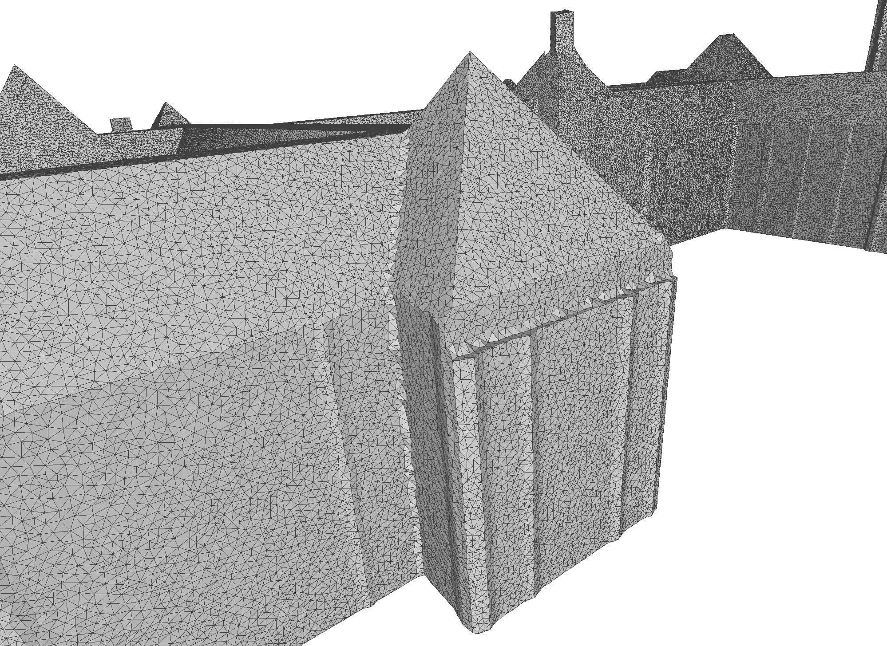
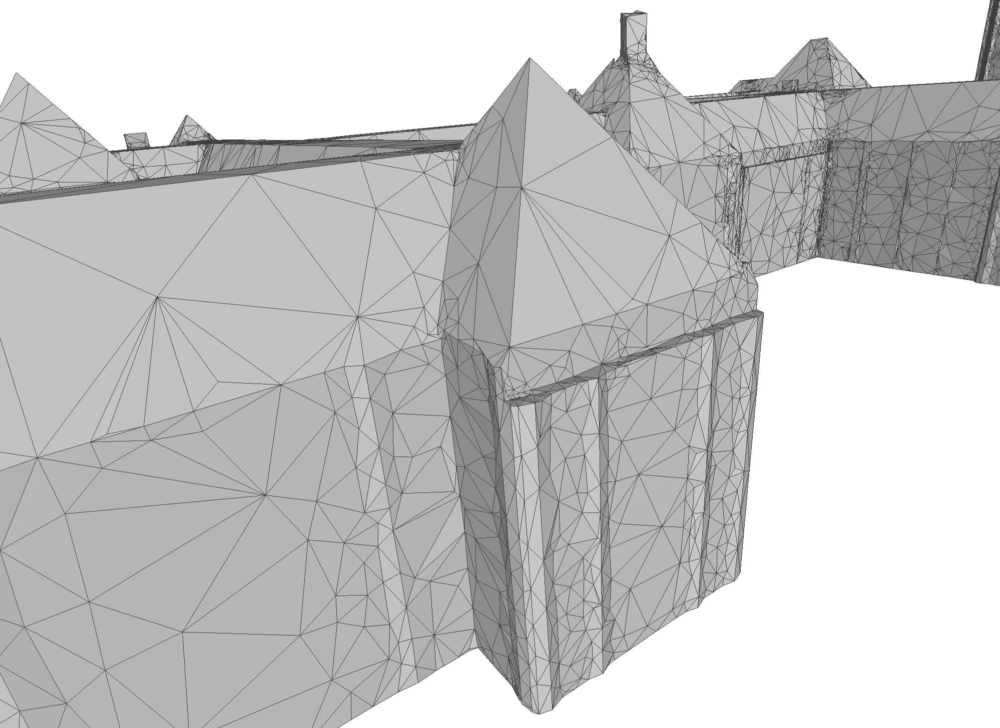

# Extended 3D Alpha Wrap

This repository contains an extension of CGAL’s 3D Alpha Wrap algorithm. The extension can be used in two ways:

- **Through the command-line interface** (`alpha_wrap_cli`).
- **In your C++ code, just like the original 3D Alpha Wrap**, by calling `CGAL::alpha_wrap_3` with the additional parameter `max_distance_to_input(tau)`. See [example_usage.cpp](src/example_usage.cpp) for an example.

The extension adds a `tau`-based local refinement criterion and a vertex insertion strategy to better preserve sharp concave features. It applies extra refinement only where the generated wrap deviates too far from the input geometry, avoiding the need for a globally smaller `alpha`.

The extension retains the guarantees of the original algorithm: termination, strict enclosure of the input, watertightness, orientability, and manifoldness.

## Comparison

<table>
  <tr>
    <td align="center">
      <br>
      <sub>Original 3D Alpha Wrap</sub>
    </td>
    <td align="center">
      <br>
      <sub>Extended Alpha Wrap (`tau` refinement)</sub>
    </td>
  </tr>
</table>

## Clone

```bash
git clone <repo-url>
```

The active targets (`alpha_wrap_cli` and `example_usage`) do not require `src/Thesis/` or the `external/masbcpp` submodule.

## Prerequisites

- CMake (>= 3.16)
- C++20 compiler
- CGAL
- `val3dity` (required when using `--validate` or `--wrap_invalid_only`)

## Build

From the repository root:

```bash
cmake -S . -B build -DCMAKE_BUILD_TYPE=Release
cmake --build build --target alpha_wrap_cli example_usage
```

If `val3dity` is not on your `PATH`, provide it explicitly:

```bash
cmake -S . -B build -DCMAKE_BUILD_TYPE=Release -DVAL3DITY_EXECUTABLE=/path/to/val3dity
```

## Command-line interface

```bash
./build/alpha_wrap_cli <input_path> <output_path> <alpha> <offset> <tau> [--validate] [--wrap_invalid_only] [--use_normal_alpha_wrap]
```

Example:

```bash
./build/alpha_wrap_cli ./example_data/input/3DBAG_aula.obj ./example_data/output/aula.obj 10 0.1 1.5 --validate
```

## Parameters

`alpha`, `offset`, and `tau` are **absolute distance values**, expressed in the same units as the input coordinates. They are not relative factors based on the bounding-box diagonal. For example, if the input coordinates are in metres, all three parameters are in metres.

- `alpha`: the alpha parameter of the original 3D Alpha Wrap algorithm; must be finite and positive.
- `offset`: the offset distance from the input geometry; must be finite and positive.
- `tau`: the maximum-distance-to-input threshold used for local refinement; must be finite and strictly greater than `offset`.

## Use like the original 3D Alpha Wrap

Include `<CGAL/alpha_wrap_3.h>` and call the algorithm as you would the original CGAL 3D Alpha Wrap, adding the `tau` parameter:

```cpp
const double alpha = 3.0;
const double offset = 0.03;
const double tau = 2.0 * offset;

Mesh wrap;
CGAL::alpha_wrap_3(mesh, alpha, offset, wrap,
                   CGAL::parameters::max_distance_to_input(tau));
```

The complete example in [example_usage.cpp](src/example_usage.cpp) shows how to read a mesh, call the extended algorithm, and write the result.

To use the extension in your own project, place `src/cgal_override/` before the installed CGAL headers in your include paths. This is already configured in this repository’s CMake setup.

After building, run the example from the build directory so its relative input and output paths resolve correctly:

```bash
cd build
./example_usage ../example_data/input/3DBAG_simpel_house.obj
```

The example writes its result to `example_data/output/output.obj`. Change `alpha`, `offset`, and `tau` in `src/example_usage.cpp` and rebuild to try different settings.

## Notes

- If a mesh input is not triangulated, the CLI triangulates it automatically before wrapping.
- `--validate` runs val3dity-based validation and repair loops.
- `--wrap_invalid_only` also uses val3dity to detect invalid groups before wrapping.
- `--use_normal_alpha_wrap` uses the CGAL overload without the `tau` parameter. The CLI still requires a valid `tau` argument.
- Missing `val3dity` does not block compilation; it is required at runtime only when using `--validate` or `--wrap_invalid_only`.
